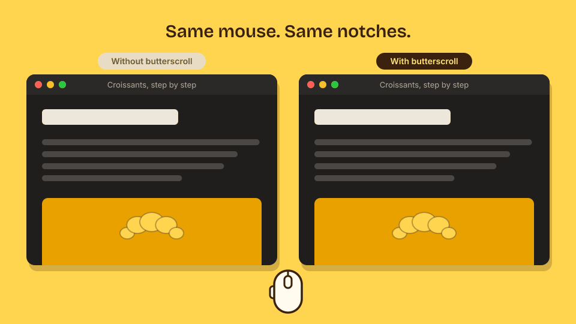
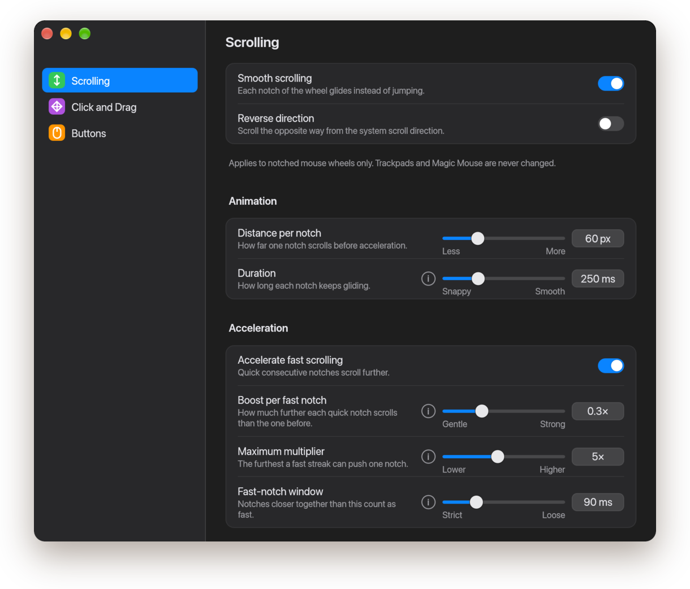
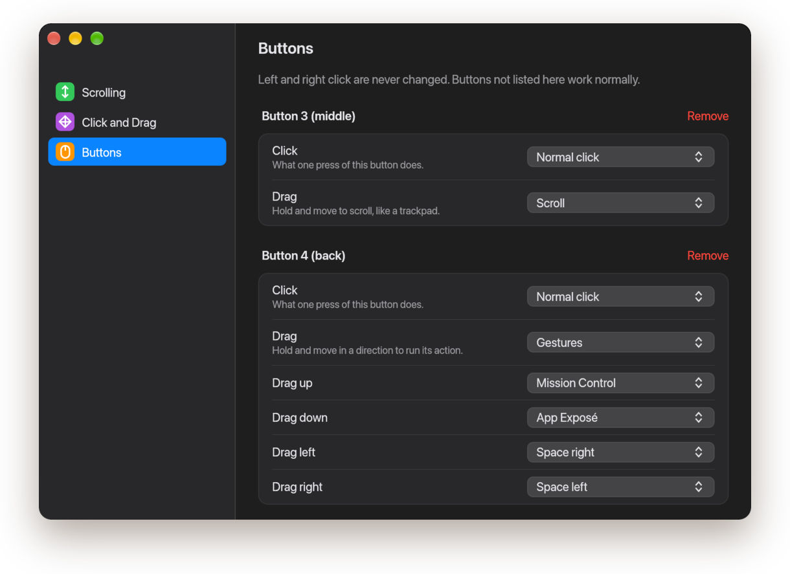
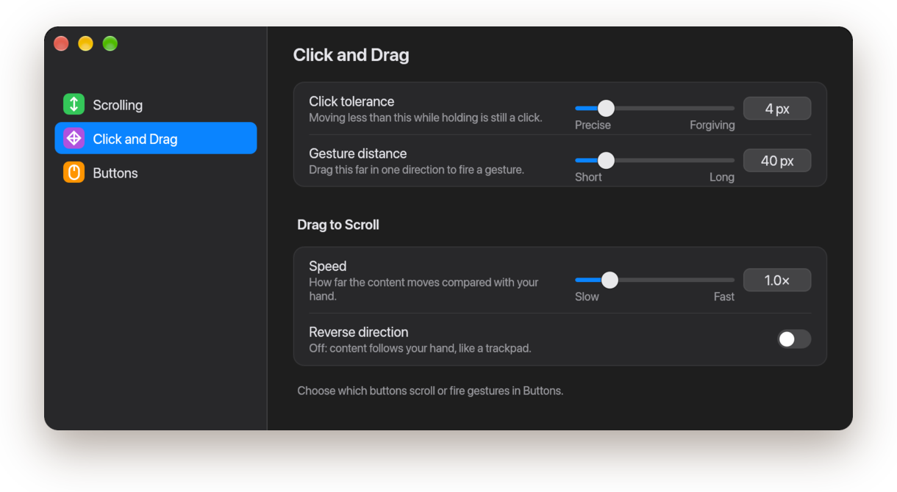
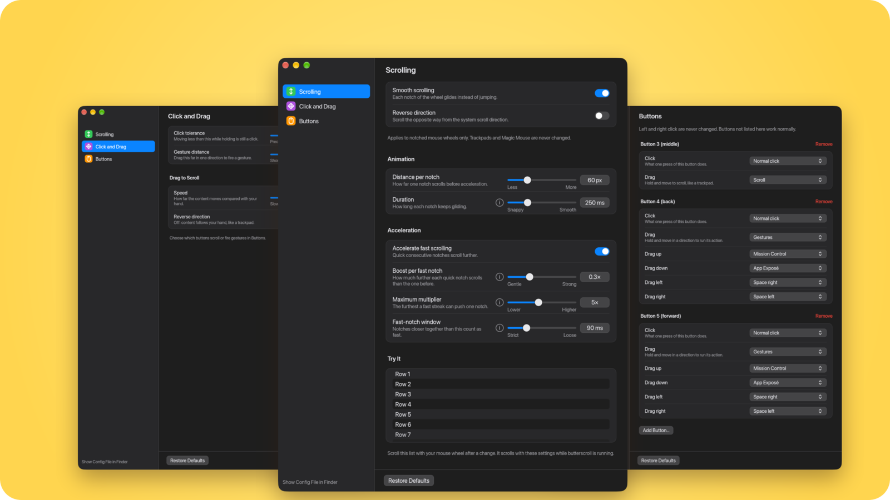

<p align="center">
  
</p>

<p align="center">
  
  
  
  
  
</p>

<h3 align="center">Your mouse wheel, minus the clunk.</h3>

<p align="center">
  butterscroll is a tiny menu-bar app that gives any ordinary mouse the glide of a trackpad.<br>
  Smooth scrolling, smarter buttons and click-and-drag gestures, in every app, for free.
</p>

<p align="center">
  <a href="#get-started"><b>Get started</b></a>
  &emsp;
  <a href="#what-it-does"><b>See what it does</b></a>
  &emsp;
  <a href="docs/"><b>Read the docs</b></a>
</p>

<br>

<p align="center">
  
</p>
<p align="center"><sub>An animated illustration, not a screen recording.</sub></p>

## Why "butterscroll"?

A regular mouse wheel scrolls in chunks. Every notch moves the page a fixed step with a
little *clunk*, and your eyes lose their place on each one. A trackpad glides.

butterscroll melts each notch into the next, so the page slides like a warm knife through
butter. One smooth spread from top to bottom. Hence the name.

> Smooth as butter. Light as a pat. Spreads to every app.

## What it does

### Smooth as butter

Every notch of the wheel glides instead of jumping. Flick it fast and quick notches carry
the page further, like momentum. Slow down and you get gentle, precise steps.

- Tune how far a notch goes, how long it glides and how hard quick notches accelerate.
- Reverse the wheel without touching your trackpad's direction.
- Trackpads and Magic Mouse are never changed. butterscroll only touches notched wheels.

<p align="center">
  
</p>

### Buttons that pull their weight

That middle click and those side buttons can do far more than sit there. Give any button
from 3 up its own job:

- Back and forward
- Mission Control, App Exposé, Show Desktop
- The next or previous Space
- Any keyboard shortcut you like, such as `⌘⇧4` for a screenshot

Back and forward keep their normal click out of the box, so your browser works exactly as
before until you decide otherwise.

<p align="center">
  
</p>

### Spread it around with click and drag

Hold a button and move the mouse:

- **Drag to scroll.** Hold the middle button and the page follows your hand, like two
  fingers on a trackpad. Long documents, wide spreadsheets, maps and timelines become one
  easy pull.
- **Gestures.** Hold back or forward and swipe up, down, left or right to open Mission
  Control or App Exposé, or to switch Spaces. One action per direction.

<p align="center">
  
</p>

### Salted to taste

The settings window looks and feels like System Settings, in light or dark appearance.

- Every setting tells you what it does, and the ⓘ buttons work through an example with
  your own values.
- A Try It list sits right under the scrolling settings, so you feel a change the moment
  you make it.
- No Save button. Changes apply within a second.
- Prefer text? Everything lives in one plain config file, and edits to it apply on their
  own.

### Stays out of the way

butterscroll lives in the menu bar, with no Dock icon, and you can pause it from there. If
macOS still needs to give it Access, the menu tells you where to grant it, and butterscroll
starts working the moment you do. No account, no tracking: it's a small native app,
written in Rust, that runs on your Mac and nowhere else.

## A peek inside

<p align="center">
  
</p>

## Get started

There is no published Release yet, so for now you build butterscroll yourself. With the
[Rust toolchain](https://rustup.rs) installed, it takes a few minutes.

1. **Build it.**

   ```sh
   git clone https://github.com/jeffujioka/butterscroll.git
   cd butterscroll && ./scripts/build.sh
   ```

2. **Run it.**

   ```sh
   target/release/butterscroll
   ```

   A little mouse appears in your menu bar.

3. **Let it in.** In System Settings → Privacy & Security, allow it under **Input
   Monitoring** and **System & App Protection Override** (on macOS before 27.3:
   **Accessibility**). Started from Terminal, Access goes to your terminal app;
   started at login, it goes to butterscroll itself. Your wheel turns to butter the moment
   it's allowed.

Want it on every login, or a build that keeps its Access across rebuilds? The
[install guide](docs/guide/install.md) covers both.

## Questions

<details>
<summary><b>Will it change how my trackpad or Magic Mouse scrolls?</b></summary>
<br>
No. butterscroll only smooths notched mouse wheels. Trackpads and Magic Mouse keep their
own scrolling.
</details>

<details>
<summary><b>Which mice work?</b></summary>
<br>
Any mouse with a notched scroll wheel. Button remapping and gestures work on buttons 3
and up: middle, back, forward and any extra buttons. Left and right click are never
changed.
</details>

<details>
<summary><b>Mission Control or Spaces actions do nothing.</b></summary>
<br>
These actions send the standard macOS shortcuts. Make sure they are turned on under System
Settings → Keyboard → Keyboard Shortcuts. See <a href="docs/guide/configure.md#actions">Actions</a>.
</details>

<details>
<summary><b>butterscroll is running but nothing happens.</b></summary>
<br>
macOS hasn't given it Access yet, or a rebuild changed its signature. The
<a href="docs/troubleshooting/macos-27-3-permission.md">troubleshooting guide</a> walks
you through it.
</details>

<details>
<summary><b>Is it really free?</b></summary>
<br>
Yes. butterscroll is open source under the MIT license.
</details>

## Docs

- [Install and run](docs/guide/install.md): build, Access, Start at login, logs
- [Configure](docs/guide/configure.md): the settings window, the config file and every action
- [How it works](docs/development/architecture.md): the code layout and the design
- [Troubleshooting](docs/troubleshooting/macos-27-3-permission.md): when butterscroll runs but does nothing
- [Changelog](CHANGELOG.md) and [releasing](RELEASING.md)

## Credits and license

Inspired by the behavior of Mac Mouse Fix; no code was copied from it.
butterscroll is released under the [MIT license](LICENSE).

<p align="center"><sub>Made for everyone who misses their trackpad the moment they plug in a mouse.</sub></p>
